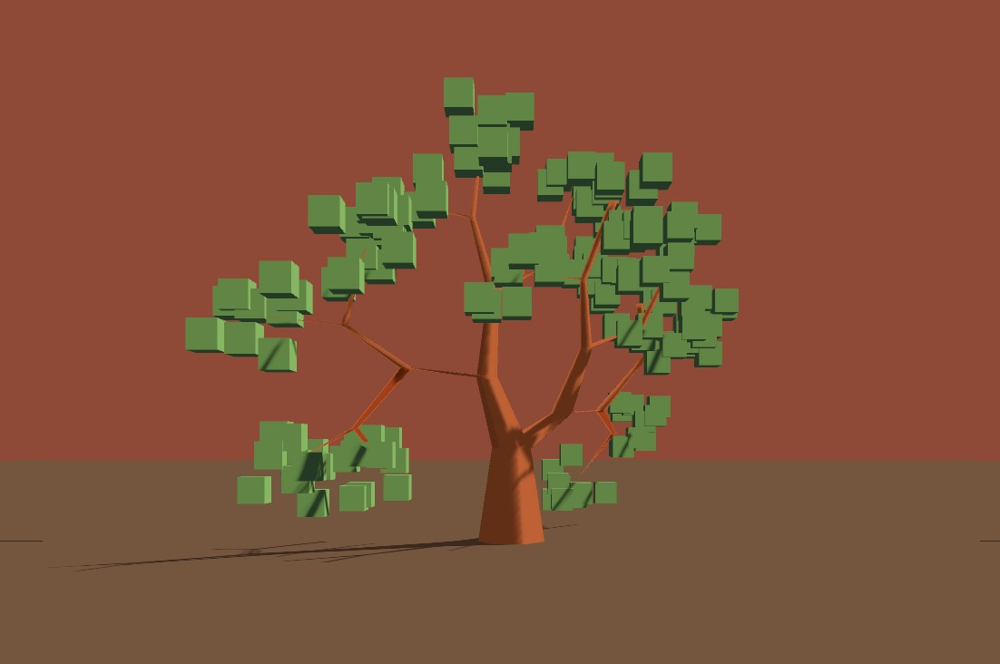
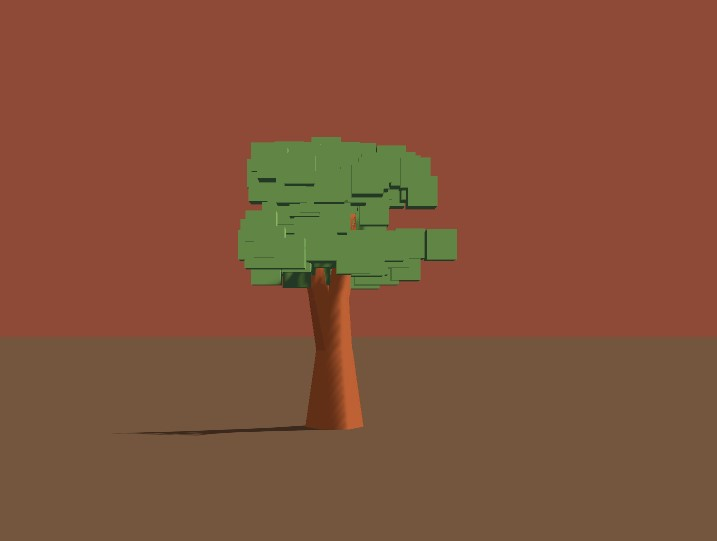


Please feel free to poke with the source code [here](https://github.com/noobnewbier/Transport-Oriented-Growth-Unity).


This is an experimental project I worked on to learn more about procedural generation and to play with another shiny new toy.

The project is for prototyping purposes and serves no commercial value. However, the possibility of creating a wide variety of trees using such a simple algorithm is fascinating to me.

I hence have a basic understanding of mesh manipulation and procedural generation.

Also, note that the algorithm was <a href="https://nickmcd.me/2020/10/19/transport-oriented-growth-and-procedural-trees/">created by Nick</a> and I held no credit for it. This work is done given Nick's acknowledgment.

