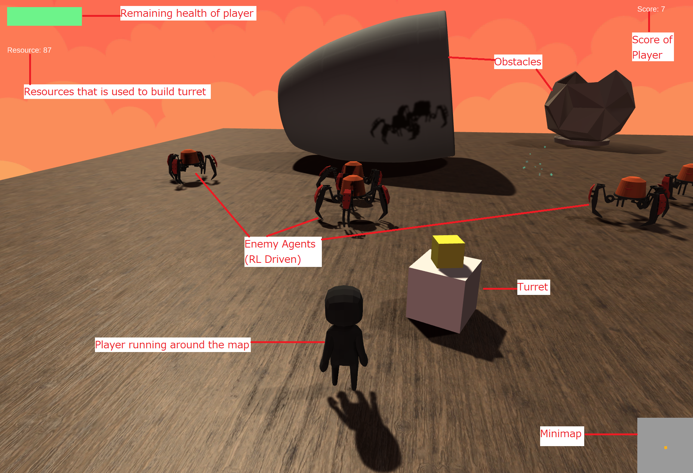

This is an experimental project I worked on to learn some cutting-edge technologies and expose myself to various components of game development.

The primary purpose of the project is to explore the possibility of using [Reinforcement Learning](https://github.com/noobnewbier/TowerDefense) in game development. 
And more importantly, every programmer needs some new toys now and then :). 

I also used this opportunity to try out some other things like procedural animation and 3D modeling.


Please feel free to poke with the source code <a href="https://github.com/noobnewbier/TowerDefense">here</a>.


